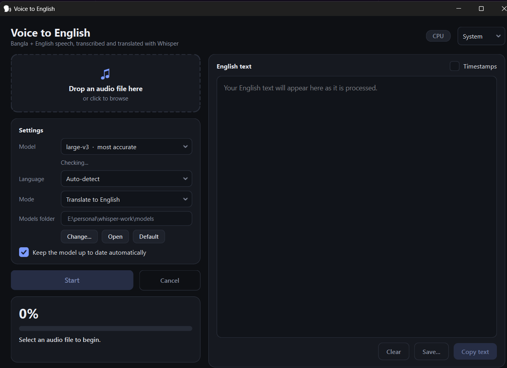

# Voice to English

A desktop app that turns **Bangla + English mixed speech** into **English text**. It runs fully offline after the first model download, using [Whisper](https://github.com/openai/whisper) through [faster-whisper](https://github.com/SYSTRAN/faster-whisper), with a modern PySide6 interface.




## Features

- **Accurate by default:** Whisper `large-v3`, beam search, silence filtering (VAD) and temperature fallback.
- **Translate or transcribe:** output English text, or keep the original language.
- **Simple workflow:** drag and drop a file or browse, press Start, copy or save the result.
- **Live results:** text appears as it is processed, with progress, speed (× real-time) and time remaining.
- **Cancel any time:** the text produced so far is kept.
- **Export:** copy to clipboard, save as `.txt`, or save as `.srt` subtitles. Optional timestamps.
- **Light, Dark and System themes**, with a responsive layout that adapts to small and large windows.
- **Model manager:**
  - choose where models are stored (and optionally move existing ones)
  - models update automatically when a newer version is published (can be turned off)
  - clear status: installed, update available, or not downloaded
- **Robust:** handles missing, empty or corrupt files, silent audio, no internet, full disks, unplugged drives, and falls back from GPU to CPU if the GPU fails.
- **Fast startup:** the window opens immediately and the heavy libraries load in the background.

## Requirements

- Windows 10/11 (the code is cross-platform, but the packaging steps below are for Windows)
- Python **3.10 – 3.12** (64-bit)
- About 4 GB free disk space for the `large-v3` model (smaller models need less)
- Internet connection for the first model download only

An NVIDIA GPU is optional (see [GPU acceleration](#gpu-acceleration-optional)).

## Quick start (from source)

```bash
git clone https://github.com/<your-username>/<your-repo>.git
cd <your-repo>

python -m venv venv
venv\Scripts\activate          # Windows
# source venv/bin/activate     # macOS / Linux

pip install -r requirements.txt
python whisper_gui.py
```

On the first Start, the selected model is downloaded automatically (this is a one-time download).

## How to use

1. Drop an audio or video file onto the window, or click it to browse (`Ctrl+O`).
2. Choose a **model**, **language** and **mode**.
3. Press **Start** (`Ctrl+Enter`). Press **Cancel** (`Esc`) to stop.
4. Copy the text (`Ctrl+Shift+C`) or save it as `.txt` / `.srt`.

Supported inputs include mp3, wav, m4a, mp4, ogg, flac, opus, webm, aac, mkv and more. FFmpeg is **not** required.

### Settings

| Setting | What it does |
|---|---|
| **Model** | `large-v3` is the most accurate. `large-v2` is a good alternative. `medium` and `small` are faster and use less memory. |
| **Language** | *Auto-detect* works for most files. If most of the speech is Bangla, choose **Bangla** for better accuracy. |
| **Mode** | *Translate to English* outputs English. *Transcribe only* keeps the original language. |
| **Models folder** | Where models are stored. Change it, open it in Explorer, or reset to the default. |
| **Keep the model up to date** | Downloads newer model versions automatically. Cancelling an update just keeps the installed version. |
| **Timestamps** | Show `[mm:ss - mm:ss]` before each segment. |
| **Theme** | System, Light or Dark. |

Default models folder on Windows: `%LOCALAPPDATA%\BanglaWhisper\models`

### Model sizes (approximate download)

| Model | Size | Notes |
|---|---|---|
| `large-v3` | ~3 GB | Most accurate. Slow on CPU. |
| `large-v2` | ~3 GB | Alternative if `large-v3` translations look off. |
| `medium` | ~1.5 GB | Good compromise on CPU. |
| `small` | ~0.5 GB | Fastest, least accurate. |

## GPU acceleration (optional)

The app uses an NVIDIA GPU automatically when one is available, and **falls back to the CPU** otherwise (the badge in the top-right shows which is in use).

For GPU use you need:

- an NVIDIA GPU with an up-to-date driver
- **CUDA 12** and **cuDNN 9** installed on the PC (check the [faster-whisper README](https://github.com/SYSTRAN/faster-whisper#gpu) for the versions that match your `ctranslate2` version)

When running from source you can alternatively install the CUDA libraries from pip, and the app will find them:

```bash
pip install nvidia-cublas-cu12 nvidia-cudnn-cu12
```

If the GPU fails at any point (missing DLLs, out of memory), the app switches to the CPU, tells you, and continues.

## Build a Windows executable

The steps create a **folder build** (not a single file), which starts faster.

```bash
# 1. In your activated virtual environment
pip install -r requirements-build.txt

# 2. Build (one line)
pyinstaller --noconfirm --clean --windowed --name BanglaWhisper --collect-all faster_whisper --collect-all ctranslate2 --collect-all av --collect-all onnxruntime --collect-all tokenizers --exclude-module tkinter --exclude-module matplotlib --exclude-module pandas --exclude-module scipy --exclude-module IPython --exclude-module pytest whisper_gui.py
```

The app is created at `dist\BanglaWhisper\BanglaWhisper.exe`.

- Distribute the **whole `dist\BanglaWhisper` folder** (zip it). The exe does not work without the files beside it.
- Add `--icon app.ico` to use your own icon.
- Models are not bundled. They download on first use, or you can copy a models folder to the target PC and point the app to it with **Models folder → Change...**
- This build does not bundle the CUDA DLLs, so GPU acceleration works only on PCs that already have CUDA 12 and cuDNN installed. Everywhere else it runs on the CPU.
- On a clean PC you may need the [Microsoft Visual C++ Redistributable (x64)](https://learn.microsoft.com/cpp/windows/latest-supported-vc-redist).
- For an installer with a Start-menu shortcut, wrap the folder with [Inno Setup](https://jrsoftware.org/isinfo.php).

## Troubleshooting

| Problem | Fix |
|---|---|
| The exe closes immediately | Rebuild without `--windowed` and run it from Command Prompt to see the error. |
| `ModuleNotFoundError: X` after building | Add `--hidden-import X` (or `--collect-all X`) to the build command. |
| Very slow transcription | You are probably on the CPU. Choose the `medium` or `small` model. |
| "Couldn't reach the model server" | Check your internet connection. Once a model is downloaded, the app works offline. |
| "Not enough free disk space" | Free up space or choose another **Models folder**. |
| GPU not used | Install CUDA 12 + cuDNN (see above) and update your NVIDIA driver. |
| Bangla/English mix is translated poorly | Set **Language** to Bangla, try `large-v2`, or transcribe first and translate the text separately. |
| Slow first launch of the exe | Antivirus scans new files on first run. Add the app folder to your exclusions. |
| Reset all saved settings | Delete the registry key `HKEY_CURRENT_USER\Software\MH\BanglaWhisper` (Windows). |

## Project structure

```
.
├── whisper_gui.py            # the whole application
├── requirements.txt          # runtime dependencies
├── requirements-build.txt    # runtime + PyInstaller
├── README.md
└── docs/
    └── screenshot.png
```

## Credits

- [OpenAI Whisper](https://github.com/openai/whisper): the speech recognition model
- [faster-whisper](https://github.com/SYSTRAN/faster-whisper) by SYSTRAN: fast CTranslate2 implementation and converted models
- [Hugging Face Hub](https://huggingface.co/): model hosting and downloads
- [PySide6 / Qt for Python](https://doc.qt.io/qtforpython-6/): the user interface

## License

Add a `LICENSE` file of your choice (for example MIT) and state it here. Whisper and faster-whisper are released under the MIT license; check the licenses of any models you use.